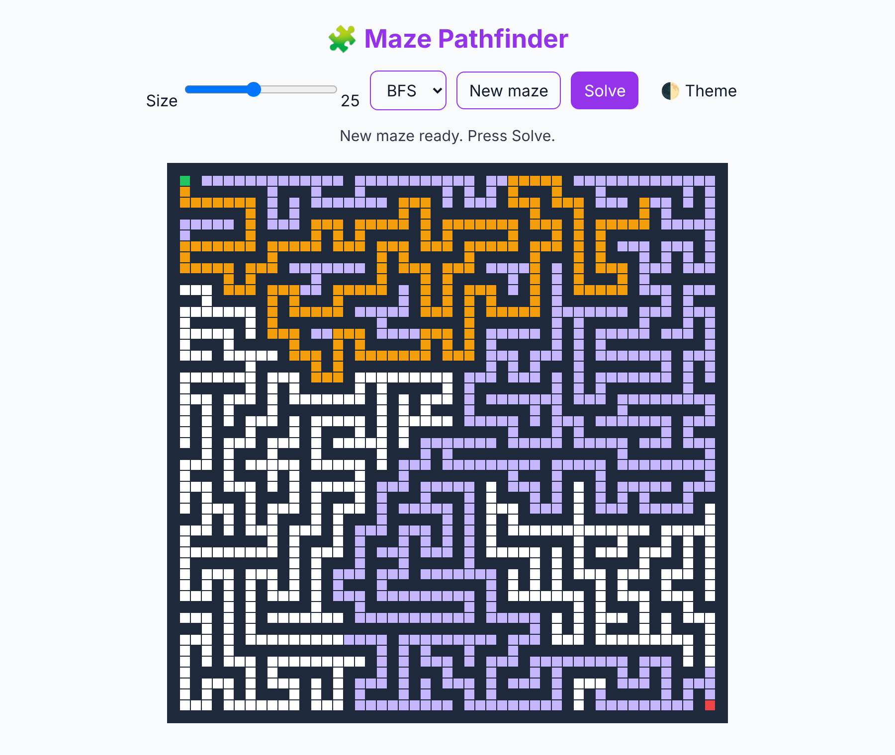

  <picture>
    <source media="(prefers-color-scheme: light)"
            srcset="https://capsule-render.vercel.app/api?type=waving&color=gradient&customColorList=6,9,12&height=220&section=header&text=MMH&fontSize=80&fontColor=1e1b4b&animation=fadeIn&fontAlignY=38&desc=Mohammad%20Mehdi%20Hasanlou&descAlignY=60&descAlign=50">
    
  </picture>

# 👾 MMH — Mohammad Mehdi Hasanlou

 

 

---

## 🟣 WHO AM I? | من کیستم؟

<table>
<tr>
<td width="50%" valign="top">

### 🇬🇧 English

Hey! I'm **Mohammad Mehdi Hasanlou**, a developer passionate about technology, web development and creative digital experiences.

I enjoy turning ideas into modern, functional and beautiful applications.

- 💻 Web Development
- 🐍 Python & Django
- 🎨 UI/UX Design
- 🚀 Building real-world projects
- 🌌 Exploring new technologies

**My mission:** Learn, create, innovate and never stop improving.

</td>
<td width="50%" valign="top" dir="rtl">

### 🇮🇷 فارسی

سلام! من **محمد مهدی حسنلو** هستم؛ علاقه‌مند به برنامه‌نویسی، توسعه وب و خلق تجربه‌های دیجیتال خلاقانه.

از تبدیل ایده‌ها به پروژه‌های مدرن، کاربردی و زیبا لذت می‌برم.

- 💻 توسعه وب
- 🐍 پایتون و جنگو
- 🎨 طراحی رابط و تجربه کاربری
- 🚀 ساخت پروژه‌های واقعی
- 🌌 یادگیری تکنولوژی‌های جدید

**هدف من:** یادگیری، خلق کردن، نوآوری و پیشرفت مداوم.

</td>
</tr>
</table>

---

## ⚡ TECHNOLOGY ARSENAL | جعبه ابزار من

# ⚡ MMH TECH ARSENAL

### 💻 Programming Languages

### ⚙️ Frameworks & Libraries

### 🛠️ Tools & Platforms

### 🗄️ Databases

---

## 💜 FEATURED PROJECTS | پروژه‌های منتخب

# 🚀 FEATURED PROJECTS
### Selected Works by MMH

<table>
<tr>
<td width="50%" valign="top">

<h3 align="center">🌐 MMH PORTFOLIO</h3>

A modern personal portfolio website showcasing skills, projects and developer identity.

**Tech:** HTML · CSS · JavaScript

</td>
<td width="50%" valign="top">

<h3 align="center">🔐 MANA VPN</h3>

A Python-based VPN service management project with Telegram bot integration.

**Tech:** Python · Telegram Bot

</td>
</tr>

<tr>
<td width="50%" valign="top">

<h3 align="center">🏋️ PRO FIT</h3>

A fitness platform for workout tracking, training management and health-focused tools.

**Tech:** HTML · Tailwind CSS · JavaScript

</td>
<td width="50%" valign="top">

<h3 align="center">💄 NAZ BEAUTY</h3>

A modern beauty e-commerce experience focused on elegant design and shopping functionality.

**Tech:** Django · JavaScript · CSS

</td>
</tr>
</table>

**MORE PROJECTS COMING SOON...**

## 💬 QUOTE OF THE DAY | جمله‌ی روز

<!-- QUOTE:START -->
> "Make it work, make it right, make it fast."
>
> — *Kent Beck*
<!-- QUOTE:END -->

---

## 🏆 ACHIEVEMENTS | دستاوردها

---

## ❓ FAQ | سؤال و جواب

<b>چطور می‌تونم باهات همکاری کنم؟</b>

از طریق ایشوها یا پول‌ریکوئست در ریپوهام، یا پیام مستقیم در گیت‌هاب.

<b>روی چه تکنولوژی‌هایی کار می‌کنی؟</b>

بیشتر پایتون، جنگو، و طراحی رابط با HTML، CSS و JavaScript.

---

## 🔭 CURRENTLY | در حال حاضر

- 🌐 در حال طراحی و توسعه‌ی سایت‌های مدرن و کاربردی
- 🐍 یادگیری و کار با پایتون و جنگو
- 🎨 بهبود تجربه‌ی کاربری و طراحی رابط

---

## 🧩 FEATURED: MAZE PATHFINDER | پروژه‌ی جدید

 

**ماز تصادفی + حل با BFS و A\*، با انیمیشن زنده**

<a href="https://github.com/mohammadpy721-debug/maze-pathfinder">📂 Source</a> ·
<a href="https://mohammadpy721-debug.github.io/maze-pathfinder/">🎮 Live demo</a>

---

## 📊 GITHUB STATISTICS

 

## 🐍 CONTRIBUTION SNAKE

<h2>🐍 CONTRIBUTION SNAKE</h2>

## 🌐 CONNECT WITH ME 🔗

  

### 💭 MY PHILOSOPHY

**"Code is not just about logic, it's about imagination."**

 

**DREAM BIG. CODE SMART. BUILD BEYOND LIMITS.**

  

